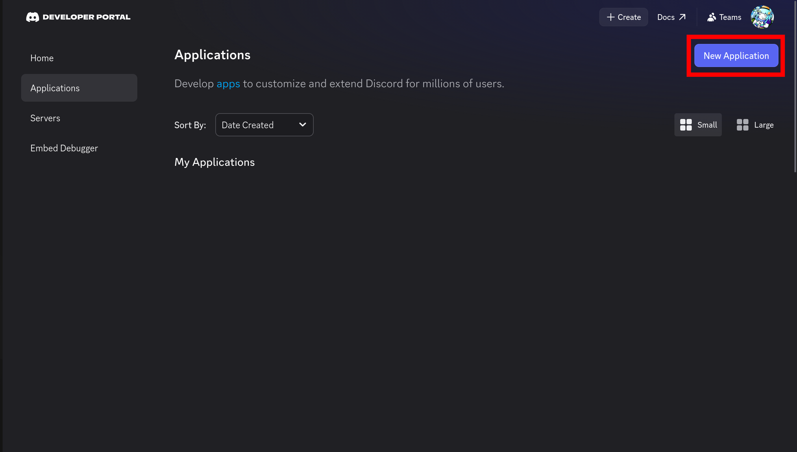
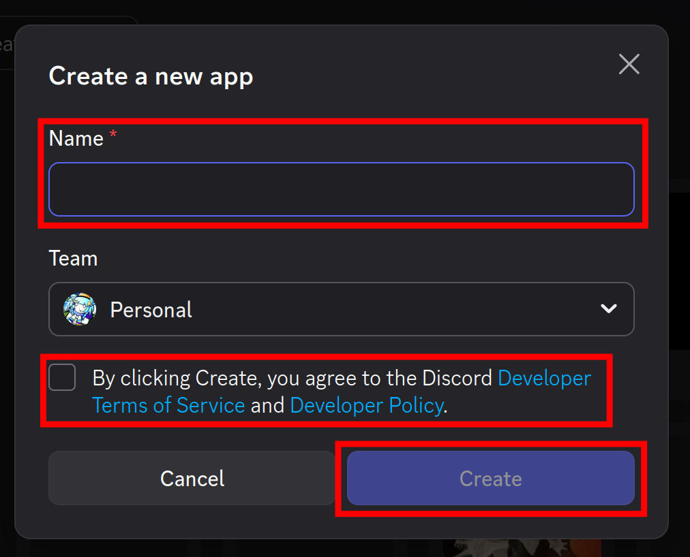
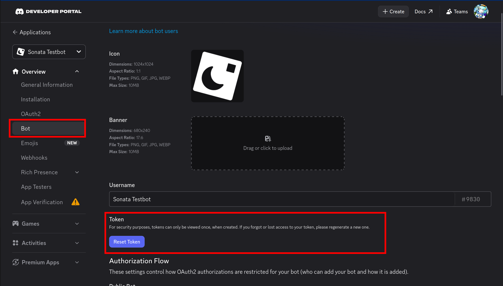
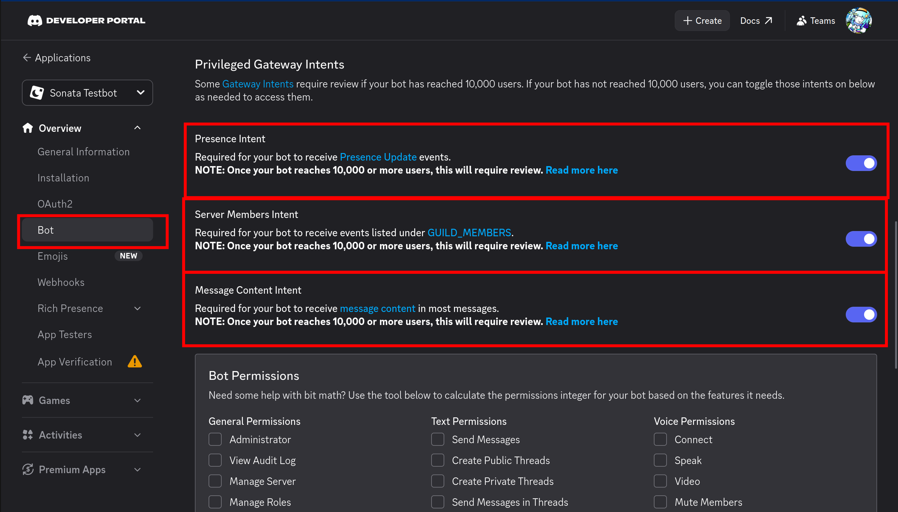
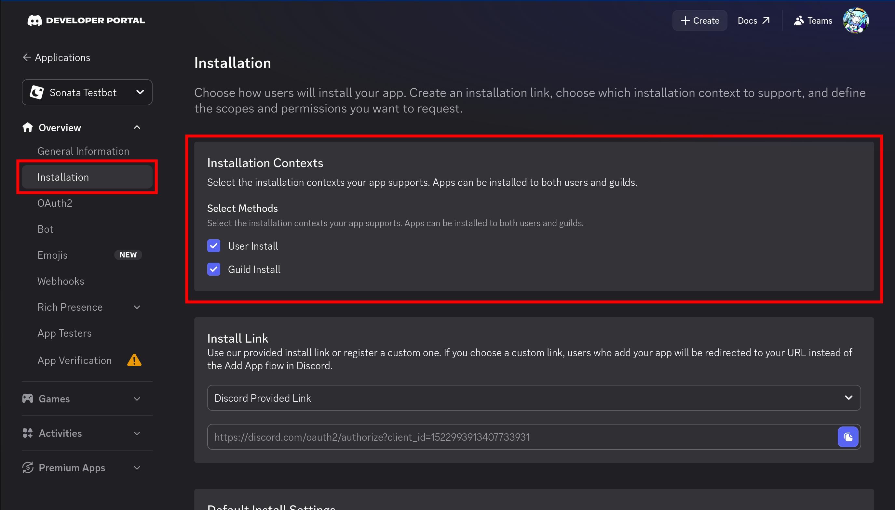
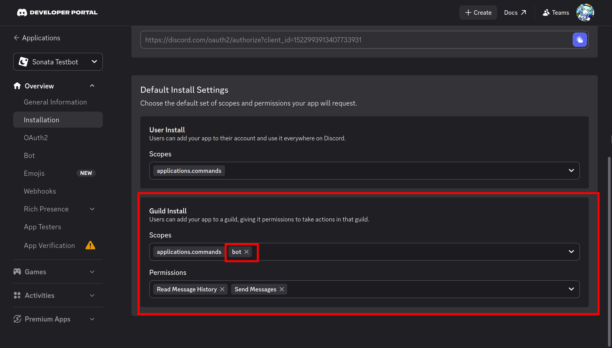

# Setting up a Discord application

Every bot belongs to a Discord *application*. You create one in the [Discord Developer Portal](https://discord.com/developers/applications).

## 1. Create the application

1. Open the [Developer Portal](https://discord.com/developers/applications) and click **New Application**.

2. Give it a name. This is the bot's default username.
{ width=50% }

The **General Information** page shows two values you may need later:

| Value | Used for |
| --- | --- |
| **Application ID** | Invite links. discord learns it on its own when the bot connects. |
| **Public Key** | Verifying [HTTP interactions](../guide/http-interactions.md). discord fetches it if you don't pass it. |

## 2. Get the token

1. Open the **Bot** page.
2. Click **Reset Token** and copy the token.


!!! danger "Keep the token secret"
    Anyone with the token can control your bot. Don't commit it, paste it in chats, or put it in screenshots. If it leaks, reset it on the same page.

discord reads the token from the `token` option, or from the `DISCORD_TOKEN` environment variable when no option is given:

=== "Environment variable"

    ```sh
    export DISCORD_TOKEN="your token"
    sn run
    ```

    ```luau
    local bot = discord.new({}) -- uses DISCORD_TOKEN
    ```

=== "A file"

    ```luau
    local fs = require("@sonata/fs")
    local token = fs.readFile("token")
    local bot = discord.new({ token = token })
    ```

    Trailing whitespace and a leading `Bot ` are stripped, so a file ending with a newline works. Add `token` to `.gitignore`.

=== "Command-line argument"

    ```luau
    -- sn run -- --token <token>
    local i = table.find(args, "--token")
    local bot = discord.new({ token = i and args[i + 1] })
    ```

## 3. Choose privileged intents

Intents decide which gateway events Discord sends to the bot. Three of them are *privileged* and must be switched on under **Bot > Privileged Gateway Intents** before the bot can use them:


| Intent | Turn it on if the bot... |
| --- | --- |
| **Message Content** | uses prefix commands in servers (`!ping`), or reads message text in events |
| **Server Members** | listens for members joining, leaving or changing, or lists members |
| **Presence** | reads users' online status and activities |

Slash commands, buttons and modals work without any of them.

If the bot asks for a privileged intent that isn't enabled in the portal, Discord would close the connection with code `4014`. discord checks for this before connecting: the intent is dropped with a warning and the bot connects without it. To fail instead, set `strictIntents = true`. See [Intents](../guide/intents.md).

## 4. Install the bot

### Installing the bot through the Discord-provided invite URL

This is the recommended way to build an invite link.

1. Go into the **"Installation"** page in your app
2. Select which **Installation Contexts** you want in your bot. These options choose where your bot can be installed *(either in a guild, or as a user install. See more below.)*

3. In the **"Guild Install"** section, add the scope `bot`. **Without this, your app won't be added as a bot into a server.** After that, you can also select permissions.

4. Finally, copy the install link and paste it into your browser. This is the same link that is opened when you click "Add App" if your bot is public.

### Installing a bot through your application ID

```text
https://discord.com/oauth2/authorize?client_id=APPLICATION_ID&scope=bot+applications.commands&permissions=PERMISSIONS
```

- `scope=bot+applications.commands` adds the bot user and allows its slash commands.
- `permissions` is the permission bitfield the bot asks for. You can compute it with discord:

    ```luau
    local discord = require("@discord")
    print(discord.permissions.toString(discord.permissions.resolve({
        "ViewChannel", "SendMessages", "EmbedLinks", "AttachFiles",
        "ReadMessageHistory", "AddReactions", "UseExternalEmojis",
    })))
    ```

You can also use the **OAuth2 > URL Generator** page in the portal.

!!! tip "The `whoami` example"
    The discord repository has an example that checks a token and prints an invite link. Run it from a clone of the repository: `sn run -- whoami --token <token>`. It also shows which privileged intents are enabled. See [Example bots](../examples/bundled.md#whoami).

### User installs

Applications can also be installed by a *user* rather than a server, so their commands work in any DM or server the user is in. To allow it, open **Installation** in the portal, tick **User Install**, and add `applications.commands` to its scopes. The install link is:

```text
https://discord.com/oauth2/authorize?client_id=APPLICATION_ID&integration_type=1&scope=applications.commands
```

See [User-installed apps](../guide/user-installs.md) for how commands opt in.

## Next

[Write your first bot](first-bot.md).
